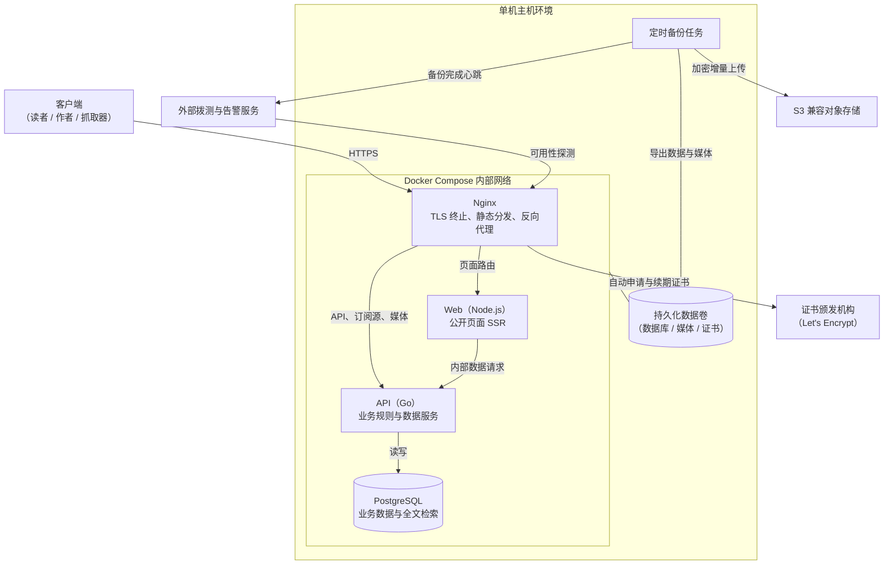
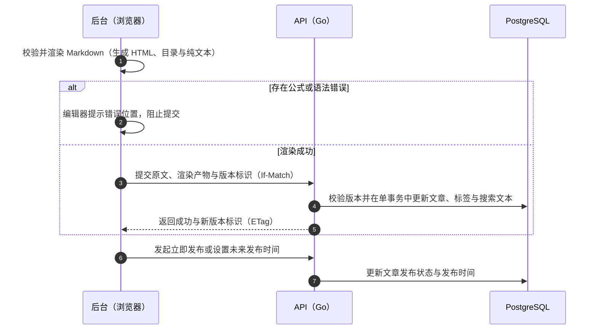
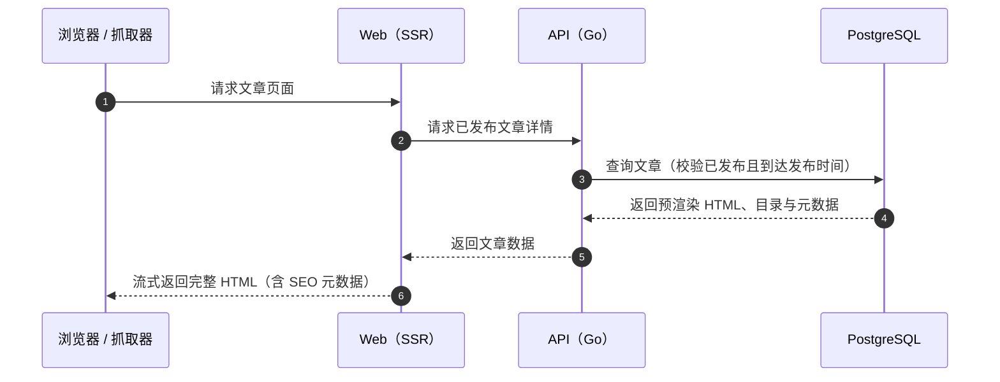

# 博客系统架构设计

本系统是面向单作者场景设计的个人博客平台，兼顾公开阅读体验、搜索引擎友好性与长期的低成本单人维护。文档从总体架构、核心读写链路、工程结构及生产运维四个方面阐述系统设计。

---

## 1. 总体架构与技术选型

### 1.1 系统拓扑与组件职责

系统采用单机容器化部署，对外服务于读者、作者及各类抓取器，并通过标准协议与外部证书机构、对象存储及拨测服务交互。

主机仅由 Nginx 容器向公网暴露 HTTP/HTTPS 端口，其余服务均隔离在内部容器网络中：

- **Nginx**：系统唯一对外入口，负责 TLS 终止与证书自动续期、前端静态资源高效分发、按路径反向代理，以及基础安全防护（接口限流、安全响应头注入）。
- **Web（Node.js）**：基于 React Router 框架模式运行，仅负责公开页面的流式服务端渲染（SSR）与 SEO 元数据组装，通过调用后端 API 获取数据。
- **API（Go）**：系统核心后端，独占数据库连接并承载全部业务规则，负责认证鉴权、文章与媒体管理、全文搜索以及订阅源（RSS/Atom）和 Sitemap 生成。
- **PostgreSQL**：持久化全部关系型业务数据，并依托 `pg_trgm` 三元组索引扩展提供中文全文检索能力。

### 1.2 核心架构决策

围绕单人维护的复杂度控制与读写性能诉求，系统确立了以下核心设计原则：

1. **模块化单体与读写职责分离**：后端采用单一 Go 进程部署，内部按业务领域划分子包，避免微服务带来的分布式运维成本；Go API 独占数据库访问，Node 进程仅承担视图渲染并单向依赖 API，保持数据访问层与安全边界的单一性。
2. **公开页面 SSR 与管理后台 CSR 结合**：面向读者与抓取器的公开页面采用服务端渲染，保障首屏加载性能与抓取器兼容性，同时避免每次发文触发全量静态构建；管理后台无 SEO 诉求，采用客户端渲染并按需加载重型编辑器依赖，使公开页面的前端资源保持极简。
3. **写时客户端渲染（Render on Write）**：博客属于典型的一次写入、多次读取场景。Markdown 解析、代码高亮与数学公式编译全部在作者后台浏览器中完成，保存时将原文与渲染产物（HTML、目录、搜索纯文本）一并提交持久化；读路径直接输出预渲染 HTML，消除服务端读路径的 CPU 开销，同时确保编辑预览与最终发布结果完全一致。
4. **同源接入与单一存储复用**：所有流量由 Nginx 统一接入并按路径分发，前后端天然同源，无需配置跨域资源共享（CORS），可直接结合严格同源策略的会话 Cookie 简化安全防护；全文检索直接复用 PostgreSQL 的 `pg_trgm` 扩展，免于引入和维护独立的搜索引擎组件。

### 1.3 技术选型概览

| 架构层次 | 技术选型 | 选型定位 |
| --- | --- | --- |
| **接入网关** | Nginx | TLS 终止、ACME 证书自动管理、静态资源分发与反向代理 |
| **后端服务** | Go + 标准库 `net/http` | 承载核心业务规则、认证鉴权与 REST API |
| **数据存储与检索** | PostgreSQL + `pg_trgm` | 关系型数据存储与中文全文检索 |
| **数据访问与迁移** | pgx + sqlc + goose | 原生数据库连接池、类型安全 SQL 代码生成与版本化迁移 |
| **前端与 SSR 框架** | React + React Router（Node.js） | 公开页面流式服务端渲染与后台单页应用 |
| **前端工程与状态** | TypeScript + Vite + TanStack Query + Tailwind CSS | 类型安全、构建打包、后台客户端数据管理与原子化样式 |
| **内容渲染与编辑** | unified（remark / rehype）+ Shiki + Temml + CodeMirror | Markdown 解析、双主题代码高亮、MathML 公式编译与后台编辑器 |
| **部署与基础设施** | Docker Compose + GitHub Actions | 单机容器编排、CI/CD 流水线 |

---

## 2. 内容生产与阅读链路

### 2.1 核心数据模型与检索

系统围绕以下核心领域实体构建数据模型：

| 实体 | 核心职责 |
| --- | --- |
| **用户与会话（Users / Sessions）** | 存储单作者凭据与服务端活跃会话状态 |
| **文章（Posts）** | 同时保存 Markdown 原文、预渲染产物（HTML、目录、搜索纯文本）及发布状态与时间 |
| **页面（Pages）** | 关于、友链等独立页面；与文章共用写时渲染的正文结构，但没有发布时间线与分类，不进入列表、订阅源与搜索 |
| **分类体系（Tags / Series / PostTags）** | 管理专栏序列与文章的多对多标签归类 |
| **媒体资源（Media）** | 记录上传图片的内容哈希与尺寸元数据，实现内容去重与前端防布局偏移 |
| **站点设置（Site Settings）** | 以单行记录保存站点标题、作者、语言、时区、导航菜单、社交链接、搜索引擎收录开关、分页与订阅源条数等可在后台调整的全局参数 |

针对中文缺乏天然空格分词的特点，系统基于 PostgreSQL 的 `pg_trgm` 扩展在文章标题、摘要与正文纯文本字段上建立三元组索引，支持子串匹配与相似度排序。

### 2.2 写路径与客户端渲染管线

渲染管线集成在管理后台前端，使实时预览与文章保存复用完全相同的处理链路：

- **文本与目录提取**：解析 Markdown 语法树，自动为各级标题生成锚点并提取目录结构，同时导出纯文本供后端建立全文检索索引。
- **双主题代码高亮**：在渲染阶段通过 Shiki 生成浅色与深色双主题内联样式，读者端仅需轻量 CSS 变量切换即可跟随系统配色无缝过渡。
- **零脚本数学公式**：在保存阶段通过 Temml 将公式编译为浏览器原生支持的 MathML，读者端无需加载公式渲染脚本；仅在包含公式的页面按需加载自托管数学字体，确保跨平台排版一致。
- **媒体处理与分发**：上传图片在服务端基于文件内容校验真实类型，重新编码以彻底剥离 EXIF 隐私信息（如地理位置）并生成多尺寸规格，按内容哈希重命名后隔离存储，配合前端响应式图片标签按需加载。

写路径通过浏览器端前置校验确保存在语法或公式错误的内容不会进入数据库；提交修改时通过 `ETag` 与 `If-Match` 请求头实现乐观并发控制，防止多标签页同时编辑互相覆盖。

### 2.3 读路径与内容分发

读路径不执行任何 Markdown 解析、代码高亮或公式编译，直接读取数据库中的预渲染结果并组装为完整 HTML 流式返回。公开页面在服务端路由层同步生成页面元数据，当文章不存在或尚未到达发布时间时返回真实的 `404` 状态码。全文订阅源（RSS/Atom）与 Sitemap 同样由后端直接基于数据库预渲染记录生成。

---

## 3. 工程结构与接口规范

### 3.1 后端分层结构

后端采用单一入口与领域分包结构，代码划分为基础支撑包（应用装配 `app`、HTTP 基础设施 `httpx`、数据存储 `store`、文章与页面共用的写时渲染正文 `content`）与业务领域包（文章 `post`、页面 `page`、认证 `auth`、媒体 `media`、订阅 `feed`、站点设置 `settings`）。各领域内部遵循三层职责划分，依赖通过构造函数显式注入：

- **传输层（Handler）**：负责请求解码、参数格式校验与响应编码，不包含业务逻辑。
- **业务层（Service）**：承载核心业务规则并划定事务边界（如文章更新、标签关联与搜索文本同步在同一数据库事务内完成）。
- **存储层（Store）**：基于 `sqlc` 封装类型安全的 SQL 查询与数据库交互。

### 3.2 前端分层与资源组织

前端严格遵循自底向上的单向依赖关系（`shared` → `features` → `app`）：

- **共享层（Shared）**：存放通用视觉组件、设计令牌（Design Tokens）以及根据接口契约自动生成的 API 类型定义。
- **特性层（Features）**：包含文章展示、Markdown 编辑器等独立业务模块，各特性模块之间互不直接引用。
- **应用与路由层（App）**：负责路由定义、布局骨架、SSR 数据加载（Loader）与特性组合。编辑器与渲染管线按路由拆分，仅在后台页面按需加载。

样式体系基于 Tailwind CSS v4：设计令牌（颜色、字号、断点等）以 `@theme` 定义并在深色模式下切换变量值，组件直接书写工具类；Markdown 正文等无法逐个加类名的生成内容由 `.prose` 组件样式统一排版。中文字体采用系统字体栈，西文字体与数学字体采用自托管方案，兼顾排版还原度与首屏加载性能。

### 3.3 接口设计原则

- **契约先行**：采用面向资源的 REST 风格，以 OpenAPI 规范作为唯一事实来源，驱动后端接口实现与前端类型代码生成。
- **分页与并发控制**：列表接口统一采用基于索引的游标分页，避免深分页性能退化；资源更新接口统一采用条件请求实现乐观并发控制。
- **标准化错误响应**：所有异常响应遵循 RFC 9457（Problem Details）标准结构，提供机器可读的错误类型与字段级校验反馈。
