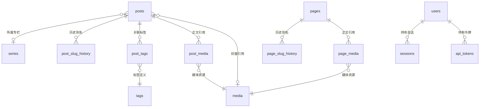

# 博客系统数据库设计

本文档定义博客系统 PostgreSQL 数据库的设计约定、数据模型、表结构、数据一致性规则与索引设计。

---

## 1. 设计约定

- **数据库与扩展**：使用 PostgreSQL，字符编码 `UTF8`，时区固定为 `UTC`，启用 `pg_trgm` 扩展以支持中文三元组全文检索。
- **命名规范**：表名使用复数蛇形命名（如 `posts`、`post_tags`），约束与索引显式命名为 `<表>_<字段>_<类型>`。
- **主键与外部标识**：主键统一使用 `bigint GENERATED ALWAYS AS IDENTITY`；公开 URL 标识统一使用 `slug` 或内容哈希 `sha256`，不暴露自增主键。
- **时间戳**：统一使用 `timestamptz`，默认值 `now()`。
- **枚举与结构化字段**：枚举状态使用 `text + CHECK` 约束；结构固定且总是整体读写的附属数据（文章目录 `toc`、图片规格列表 `variants`）使用 `jsonb` 存储。
- **并发控制**：所有可经接口修改的业务表（`posts`、`pages`、`tags`、`series`、`media`、`site_settings`）均包含 `version integer NOT NULL DEFAULT 1` 列，作为乐观锁版本号。
- **删除策略**：不做软删除，依靠外键约束（`CASCADE` / `RESTRICT`）维护引用完整性。

---

## 2. 数据模型



| 表名 | 职责 |
| --- | --- |
| `users` | 作者账号与密码哈希凭据 |
| `sessions` | 服务端会话状态（仅存令牌哈希） |
| `api_tokens` | 供 CLI 与 agent 使用的 API 令牌及其权限范围（仅存令牌哈希） |
| `posts` | 文章原文、预渲染产物、发布状态与专栏归属 |
| `post_slug_history` | 文章修改 `slug` 后保留的历史别名，用于重定向 |
| `tags` | 标签定义 |
| `post_tags` | 文章与标签的多对多关联 |
| `series` | 专栏定义 |
| `media` | 上传图片的内容哈希、尺寸与多规格元数据 |
| `post_media` | 文章正文对图片的引用关系 |
| `pages` | 独立页面的原文、预渲染产物与发布状态 |
| `page_slug_history` | 页面修改 `slug` 后保留的历史别名，用于重定向 |
| `page_media` | 页面正文对图片的引用关系 |
| `media_references`（视图） | 图片引用关系的统一汇总口径 |
| `site_settings` | 站点级可配置参数（单行表，与其他表无关联） |

---

## 3. 表结构定义

### 3.1 用户表 `users`

| 字段 | 类型 | 约束 | 说明 |
| --- | --- | --- | --- |
| `id` | `bigint` | PK | 自增主键 |
| `username` | `text` | NOT NULL, UNIQUE, `^[a-z0-9_]{3,32}$` | 登录用户名 |
| `display_name` | `text` | NOT NULL | 展示名称 |
| `password_hash` | `text` | NOT NULL | Argon2id PHC 格式哈希字符串 |
| `created_at` | `timestamptz` | NOT NULL, DEFAULT `now()` | 创建时间 |
| `updated_at` | `timestamptz` | NOT NULL, DEFAULT `now()` | 更新时间 |

### 3.2 会话表 `sessions`

| 字段 | 类型 | 约束 | 说明 |
| --- | --- | --- | --- |
| `id` | `bigint` | PK | 会话标识 |
| `token_hash` | `bytea` | NOT NULL, UNIQUE, `octet_length = 32` | 会话令牌的 SHA-256 哈希 |
| `user_id` | `bigint` | NOT NULL, FK → `users(id)` ON DELETE CASCADE | 所属用户 |
| `created_at` | `timestamptz` | NOT NULL, DEFAULT `now()` | 创建时间（计算绝对过期上限） |
| `last_seen_at` | `timestamptz` | NOT NULL, DEFAULT `now()` | 最近活跃时间 |
| `expires_at` | `timestamptz` | NOT NULL | 当前过期时间 |
| `user_agent` | `text` | NOT NULL, DEFAULT `''` | 客户端 User-Agent |
| `ip` | `inet` | NULL | 创建会话时的客户端 IP |

### 3.3 文章表 `posts`

| 字段 | 类型 | 约束 | 说明 |
| --- | --- | --- | --- |
| `id` | `bigint` | PK | 自增主键 |
| `slug` | `text` | NOT NULL, UNIQUE, `^[a-z0-9]+(-[a-z0-9]+)*$`, 长度 ≤ 100 | 公开 URL 标识 |
| `title` | `text` | NOT NULL, 长度 1–200 | 标题 |
| `summary` | `text` | NOT NULL, DEFAULT `''`, 长度 ≤ 500 | 摘要 |
| `body_md` | `text` | NOT NULL, DEFAULT `''` | Markdown 原文 |
| `body_html` | `text` | NOT NULL, DEFAULT `''` | 预渲染 HTML |
| `toc` | `jsonb` | NOT NULL, DEFAULT `'[]'`, 类型为 `array` | 目录结构 |
| `plain_text` | `text` | NOT NULL, DEFAULT `''` | 正文纯文本（供全文检索） |
| `word_count` | `integer` | NOT NULL, DEFAULT 0, `>= 0` | 字数统计 |
| `has_math` | `boolean` | NOT NULL, DEFAULT `false` | 是否包含数学公式 |
| `renderer_version` | `text` | NOT NULL, DEFAULT `''` | 渲染管线版本标识 |
| `cover_media_id` | `bigint` | NULL, FK → `media(id)` ON DELETE RESTRICT | 封面图片 |
| `series_id` | `bigint` | NULL, FK → `series(id)` ON DELETE RESTRICT | 所属专栏 |
| `series_position` | `integer` | NULL | 专栏内排序序号 |
| `status` | `text` | NOT NULL, DEFAULT `'draft'`, `IN ('draft', 'published')` | 持久化状态 |
| `published_at` | `timestamptz` | NULL | 发布时间（`published` 时非空） |
| `version` | `integer` | NOT NULL, DEFAULT 1 | 乐观锁版本号 |
| `created_at` | `timestamptz` | NOT NULL, DEFAULT `now()` | 创建时间 |
| `updated_at` | `timestamptz` | NOT NULL, DEFAULT `now()` | 更新时间 |

**表级复合约束**：

- `posts_published_at_required`：`CHECK (status = 'draft' OR published_at IS NOT NULL)`
- `posts_series_pair`：`CHECK ((series_id IS NULL) = (series_position IS NULL))`
- `posts_series_position_key`：`UNIQUE (series_id, series_position) DEFERRABLE INITIALLY DEFERRED`

**`toc` JSON 结构**：

```json
[
  { "depth": 2, "id": "总体架构", "text": "总体架构" },
  { "depth": 3, "id": "核心架构决策", "text": "核心架构决策" }
]
```

### 3.4 文章历史别名表 `post_slug_history`

| 字段 | 类型 | 约束 | 说明 |
| --- | --- | --- | --- |
| `old_slug` | `text` | PK | 历史 `slug` |
| `post_id` | `bigint` | NOT NULL, FK → `posts(id)` ON DELETE CASCADE | 指向的文章 |
| `created_at` | `timestamptz` | NOT NULL, DEFAULT `now()` | 记录时间 |

### 3.5 标签表 `tags` 与关联表 `post_tags`

**`tags`**

| 字段 | 类型 | 约束 | 说明 |
| --- | --- | --- | --- |
| `id` | `bigint` | PK | 自增主键 |
| `slug` | `text` | NOT NULL, UNIQUE, `^[a-z0-9]+(-[a-z0-9]+)*$`, 长度 ≤ 50 | URL 标识 |
| `name` | `text` | NOT NULL, 长度 1–50, `lower(name)` UNIQUE | 标签名称（大小写不敏感唯一） |
| `version` | `integer` | NOT NULL, DEFAULT 1 | 乐观锁版本号 |
| `created_at` | `timestamptz` | NOT NULL, DEFAULT `now()` | 创建时间 |
| `updated_at` | `timestamptz` | NOT NULL, DEFAULT `now()` | 更新时间 |

**`post_tags`**

| 字段 | 类型 | 约束 | 说明 |
| --- | --- | --- | --- |
| `post_id` | `bigint` | PK, FK → `posts(id)` ON DELETE CASCADE | 文章 ID |
| `tag_id` | `bigint` | PK, FK → `tags(id)` ON DELETE CASCADE | 标签 ID |

### 3.6 专栏表 `series`

| 字段 | 类型 | 约束 | 说明 |
| --- | --- | --- | --- |
| `id` | `bigint` | PK | 自增主键 |
| `slug` | `text` | NOT NULL, UNIQUE, `^[a-z0-9]+(-[a-z0-9]+)*$`, 长度 ≤ 100 | URL 标识 |
| `title` | `text` | NOT NULL, 长度 1–200 | 专栏标题 |
| `description` | `text` | NOT NULL, DEFAULT `''`, 长度 ≤ 2000 | 专栏简介 |
| `version` | `integer` | NOT NULL, DEFAULT 1 | 乐观锁版本号 |
| `created_at` | `timestamptz` | NOT NULL, DEFAULT `now()` | 创建时间 |
| `updated_at` | `timestamptz` | NOT NULL, DEFAULT `now()` | 更新时间 |

### 3.7 媒体表 `media` 与引用表 `post_media`

**`media`**

| 字段 | 类型 | 约束 | 说明 |
| --- | --- | --- | --- |
| `id` | `bigint` | PK | 自增主键 |
| `sha256` | `text` | NOT NULL, UNIQUE, `^[0-9a-f]{64}$` | 原始文件 SHA-256 哈希 |
| `width` | `integer` | NOT NULL, `> 0` | 图片宽度（像素） |
| `height` | `integer` | NOT NULL, `> 0` | 图片高度（像素） |
| `byte_size` | `bigint` | NOT NULL, `> 0` | 原始文件字节大小 |
| `variants` | `jsonb` | NOT NULL, 类型为 `array` | 衍生规格元数据列表 |
| `original_filename` | `text` | NOT NULL, DEFAULT `''` | 原始文件名 |
| `alt` | `text` | NOT NULL, DEFAULT `''`, 长度 ≤ 500 | 默认替代文本 |
| `version` | `integer` | NOT NULL, DEFAULT 1 | 乐观锁版本号 |
| `created_at` | `timestamptz` | NOT NULL, DEFAULT `now()` | 创建时间 |
| `updated_at` | `timestamptz` | NOT NULL, DEFAULT `now()` | 更新时间 |

**`variants` JSON 结构**：

```json
[
  { "width": 480,  "height": 320,  "format": "webp", "size": 21544 },
  { "width": 960,  "height": 640,  "format": "webp", "size": 68210 },
  { "width": 1600, "height": 1067, "format": "webp", "size": 152330 }
]
```

**`post_media`**

| 字段 | 类型 | 约束 | 说明 |
| --- | --- | --- | --- |
| `post_id` | `bigint` | PK, FK → `posts(id)` ON DELETE CASCADE | 文章 ID |
| `media_id` | `bigint` | PK, FK → `media(id)` ON DELETE RESTRICT | 被引用的图片 ID |

### 3.8 页面表 `pages` 及其关联表

页面与文章分表存储：二者共用写时渲染的正文列，但文章特有的发布时间线、标签、专栏与封面对页面没有意义，分表使这些非法状态无法写入，并让页面拥有独立的 `slug` 命名空间（公开地址为 `/{slug}`）。

**`pages`**

| 字段 | 类型 | 约束 | 说明 |
| --- | --- | --- | --- |
| `id` | `bigint` | PK | 自增主键 |
| `slug` | `text` | NOT NULL, UNIQUE, `^[a-z0-9]+(-[a-z0-9]+)*$`, 长度 ≤ 100 | 公开 URL 标识（站点保留路径由应用层拒绝） |
| `title` | `text` | NOT NULL, 长度 1–200 | 标题 |
| `description` | `text` | NOT NULL, DEFAULT `''`, 长度 ≤ 500 | Meta 描述 |
| `body_md` | `text` | NOT NULL, DEFAULT `''` | Markdown 原文 |
| `body_html` | `text` | NOT NULL, DEFAULT `''` | 预渲染 HTML |
| `toc` | `jsonb` | NOT NULL, DEFAULT `'[]'`, 类型为 `array` | 目录结构（同 `posts.toc`） |
| `plain_text` | `text` | NOT NULL, DEFAULT `''` | 正文纯文本 |
| `has_math` | `boolean` | NOT NULL, DEFAULT `false` | 是否包含数学公式 |
| `renderer_version` | `text` | NOT NULL, DEFAULT `''` | 渲染管线版本标识 |
| `status` | `text` | NOT NULL, DEFAULT `'draft'`, `IN ('draft', 'published')` | 发布状态（页面没有定时发布） |
| `version` | `integer` | NOT NULL, DEFAULT 1 | 乐观锁版本号 |
| `created_at` | `timestamptz` | NOT NULL, DEFAULT `now()` | 创建时间 |
| `updated_at` | `timestamptz` | NOT NULL, DEFAULT `now()` | 更新时间 |

**`page_slug_history`**：结构同 `post_slug_history`，外键 `page_id` → `pages(id)` ON DELETE CASCADE。

**`page_media`**：结构同 `post_media`，外键 `page_id` → `pages(id)` ON DELETE CASCADE，`media_id` → `media(id)` ON DELETE RESTRICT。

### 3.9 媒体引用视图 `media_references`

汇总文章正文（`post_media`）、文章封面（`posts.cover_media_id`）与页面正文（`page_media`）三种引用来源，输出 `(media_id, owner_type, owner_id, title)`，`owner_type` 为 `post` 或 `page`。以 `UNION` 去重，同一文章以正文和封面同时引用一张图片时只计一次。引用计数、未引用筛选与引用方列表均基于此视图；删除保护仍由各引用表的 `ON DELETE RESTRICT` 外键保证，新增引用来源时需同时增加外键并修改此视图。

### 3.10 站点设置表 `site_settings`

单行表：`id` 固定为 `1`，由迁移脚本以默认值插入唯一记录，应用只读取和更新该行，不新增或删除。采用强类型列而非键值表，以便沿用数据库 `CHECK` 约束与 `sqlc` 类型生成。

| 字段 | 类型 | 约束 | 说明 |
| --- | --- | --- | --- |
| `id` | `smallint` | PK, DEFAULT 1, `= 1` | 单例主键 |
| `title` | `text` | NOT NULL, DEFAULT `'Blog'`, 长度 1–100 | 站点标题（页面标题、订阅源标题） |
| `subtitle` | `text` | NOT NULL, DEFAULT `''`, 长度 ≤ 200 | 站点副标题（页头展示） |
| `description` | `text` | NOT NULL, DEFAULT `''`, 长度 ≤ 500 | 站点简介（Meta 描述、订阅源副标题） |
| `author` | `text` | NOT NULL, DEFAULT `'Author'`, 长度 1–100 | 作者署名（订阅源作者） |
| `language` | `text` | NOT NULL, DEFAULT `'zh-CN'`, `^[A-Za-z]{2,3}(-[A-Za-z0-9]{1,8})*$`, 长度 ≤ 35 | 站点语言（BCP 47 语言标签） |
| `timezone` | `text` | NOT NULL, DEFAULT `'Asia/Shanghai'`, 长度 1–64 | 展示时区（IANA 名称，由应用层校验），用于页面日期格式化与归档分组；数据库时间仍统一存储为 UTC |
| `footer_text` | `text` | NOT NULL, DEFAULT `''`, 长度 ≤ 500 | 页脚纯文本（版权声明、备案号等） |
| `navigation` | `jsonb` | NOT NULL, DEFAULT `'[]'`, 类型为 `array`, ≤ 10 项 | 页头导航菜单 |
| `social_links` | `jsonb` | NOT NULL, DEFAULT `'[]'`, 类型为 `array`, ≤ 10 项 | 社交账号链接 |
| `noindex` | `boolean` | NOT NULL, DEFAULT `false` | 是否禁止搜索引擎收录 |
| `posts_per_page` | `integer` | NOT NULL, DEFAULT 20, 1–50 | 公开文章列表每页条数 |
| `feed_item_count` | `integer` | NOT NULL, DEFAULT 20, 1–100 | 订阅源收录的最新文章数 |
| `version` | `integer` | NOT NULL, DEFAULT 1 | 乐观锁版本号 |
| `updated_at` | `timestamptz` | NOT NULL, DEFAULT `now()` | 更新时间 |

**`navigation` 与 `social_links` JSON 结构**：

```json
[ { "label": "关于", "url": "/about" }, { "label": "GitHub", "url": "https://github.com/wu" } ]
```

```json
[ { "platform": "github", "url": "https://github.com/wu" }, { "platform": "email", "url": "mailto:wu@example.com" } ]
```

### 3.11 API 令牌表 `api_tokens`

API 令牌以 `Authorization: Bearer blog_pat_<base64url>` 提交，与会话一样只保存 SHA-256 哈希；明文只在签发时返回一次。令牌没有滑动续期，可选的 `expires_at` 为固定过期时间。

| 字段 | 类型 | 约束 | 说明 |
| --- | --- | --- | --- |
| `id` | `bigint` | PK | 令牌标识 |
| `user_id` | `bigint` | NOT NULL, FK → `users(id)` ON DELETE CASCADE | 所属用户 |
| `name` | `text` | NOT NULL, 长度 1–100, UNIQUE (`user_id`, `name`) | 令牌名称（如 `claude-code`），用于识别与按名吊销 |
| `token_hash` | `bytea` | NOT NULL, UNIQUE, `octet_length = 32` | 令牌明文的 SHA-256 哈希 |
| `scopes` | `text[]` | NOT NULL, 非空, 取值 ⊆ {`content:read`, `content:write`, `content:publish`, `media:write`, `settings:write`} | 权限范围 |
| `created_at` | `timestamptz` | NOT NULL, DEFAULT `now()` | 签发时间 |
| `last_used_at` | `timestamptz` | NULL | 最近使用时间（最多每分钟更新一次） |
| `expires_at` | `timestamptz` | NULL | 过期时间，`NULL` 表示不过期 |

---

## 4. 数据一致性与状态规则

### 4.1 文章发布状态派生

数据库仅存储 `draft` 与 `published` 两种持久化状态，对外展示的三态由 `status` 与 `published_at` 共同决定：

| 派生状态 | 判定条件 | 公开可见 |
| --- | --- | --- |
| 草稿（`draft`） | `status = 'draft'` | 否 |
| 定时发布（`scheduled`） | `status = 'published' AND published_at > now()` | 否 |
| 已发布（`published`） | `status = 'published' AND published_at <= now()` | 是 |

所有面向读者的公开文章查询统一固定附加 `status = 'published' AND published_at <= now()` 过滤条件。页面只有 `draft` 与 `published` 两态，公开查询附加 `status = 'published'`。

### 4.2 乐观并发控制

- 对 `posts`、`pages`、`tags`、`series`、`media`、`site_settings` 的更新在事务内先以 `SELECT … FOR UPDATE` 锁定目标行并比对 `If-Match` 与当前 `version`，通过后执行更新并 `version = version + 1, updated_at = now()`。
- 文章与页面的发布、撤回发布同样递增 `version`；状态未发生变化的发布或撤回不写库、不递增版本。
- 调整专栏内文章顺序仅更新 `posts.series_position`，不递增文章的 `version`。

### 4.3 关键事务边界

- **保存页面**：在同一事务中更新 `pages` 主记录、维护 `page_slug_history`（规则同文章），并重建 `page_media` 图片引用。
- **保存文章**：在同一事务中更新 `posts` 主记录、维护 `post_slug_history`（当 `slug` 变更时记录旧值，并移除与新 `slug` 同名的历史记录）、同步 `post_tags` 关联、分配专栏序号 `series_position`（当首次加入或切换专栏时取 `max + 1`），并重建 `post_media` 图片引用。
- **删除专栏**：在同一事务中先将所属文章的 `series_id` 与 `series_position` 置空，再删除 `series` 记录。
- **修改密码**：在同一事务中更新 `users.password_hash` 并删除当前会话外的其余 `sessions` 记录；`api_tokens` 不受影响。
- **重置密码**（服务器上执行 `blogd user reset-password`）：在同一事务中更新密码哈希，并删除该用户的全部 `sessions` 与 `api_tokens` 记录。
- **重新渲染**：渲染器升级后逐条更新过期文章与页面的渲染产物，以 `WHERE id = … AND version = …` 条件更新并递增 `version`；期间被编辑过的记录跳过（编辑保存时已用新渲染器渲染）。

---

## 5. 索引与检索设计

### 5.1 索引清单

| 所属表 | 索引名 | 索引定义 | 用途 |
| --- | --- | --- | --- |
| `users` | `users_username_key` | `UNIQUE (username)` | 登录查询 |
| `sessions` | `sessions_token_hash_key` | `UNIQUE (token_hash)` | 会话令牌校验 |
| `sessions` | `sessions_user_id_idx` | `(user_id)` | 用户活跃会话查询与批量吊销 |
| `sessions` | `sessions_expires_at_idx` | `(expires_at)` | 过期会话清理 |
| `api_tokens` | `api_tokens_token_hash_key` | `UNIQUE (token_hash)` | 令牌校验 |
| `api_tokens` | `api_tokens_user_name_key` | `UNIQUE (user_id, name)` | 同一用户内令牌名称唯一、按名吊销 |
| `api_tokens` | `api_tokens_user_id_idx` | `(user_id)` | 用户令牌列表 |
| `posts` | `posts_slug_key` | `UNIQUE (slug)` | 按 `slug` 查询文章详情 |
| `posts` | `posts_published_idx` | `(published_at DESC, id DESC) WHERE status = 'published'` | 公开文章列表游标分页、订阅源与 Sitemap |
| `posts` | `posts_updated_idx` | `(updated_at DESC, id DESC)` | 后台文章列表游标分页 |
| `posts` | `posts_series_position_key` | `UNIQUE (series_id, series_position) DEFERRABLE INITIALLY DEFERRED` | 专栏文章排序与事务内重排 |
| `posts` | `posts_title_trgm_idx` | `GIN (title gin_trgm_ops)` | 标题全文检索 |
| `posts` | `posts_summary_trgm_idx` | `GIN (summary gin_trgm_ops)` | 摘要全文检索 |
| `posts` | `posts_plain_text_trgm_idx` | `GIN (plain_text gin_trgm_ops)` | 正文全文检索 |
| `post_slug_history` | `post_slug_history_pkey` | `PRIMARY KEY (old_slug)` | 历史别名重定向查找 |
| `post_slug_history` | `post_slug_history_post_id_idx` | `(post_id)` | 文章删除时级联清理 |
| `tags` | `tags_slug_key` | `UNIQUE (slug)` | 按 `slug` 查询标签 |
| `tags` | `tags_name_lower_key` | `UNIQUE (lower(name))` | 标签名大小写不敏感唯一 |
| `post_tags` | `post_tags_pkey` | `PRIMARY KEY (post_id, tag_id)` | 查询文章关联的标签 |
| `post_tags` | `post_tags_tag_id_idx` | `(tag_id, post_id)` | 查询标签下的文章与文章计数 |
| `series` | `series_slug_key` | `UNIQUE (slug)` | 按 `slug` 查询专栏 |
| `media` | `media_sha256_key` | `UNIQUE (sha256)` | 内容哈希去重与批量查询 |
| `post_media` | `post_media_pkey` | `PRIMARY KEY (post_id, media_id)` | 同步文章图片引用 |
| `post_media` | `post_media_media_id_idx` | `(media_id)` | 图片删除保护校验与未引用图片筛选 |
| `pages` | `pages_slug_key` | `UNIQUE (slug)` | 按 `slug` 查询页面 |
| `page_slug_history` | `page_slug_history_pkey` | `PRIMARY KEY (old_slug)` | 历史别名重定向查找 |
| `page_slug_history` | `page_slug_history_page_id_idx` | `(page_id)` | 页面删除时级联清理 |
| `page_media` | `page_media_pkey` | `PRIMARY KEY (page_id, media_id)` | 同步页面图片引用 |
| `page_media` | `page_media_media_id_idx` | `(media_id)` | 图片删除保护校验与未引用图片筛选 |
| `site_settings` | `site_settings_pkey` | `PRIMARY KEY (id)` | 单例记录读取 |

### 5.2 分页与全文检索规则

- **游标分页**：公开文章列表以 `(published_at DESC, id DESC)` 为排序键，后台文章列表以 `(updated_at DESC, id DESC)` 为排序键；分页查询以 `(排序时间戳, id) < (@cursor_ts, @cursor_id)` 进行范围过滤。
- **全文检索**：基于 `title`、`summary`、`plain_text` 三个字段的 `GIN (gin_trgm_ops)` 索引，使用 `ILIKE` 进行子串召回，并按字段权重计算综合相关度排序：

  $$
  \text{score} = \max\bigl(3 \times \text{word\_similarity}(q, \text{title}),\; 2 \times \text{word\_similarity}(q, \text{summary}),\; \text{word\_similarity}(q, \text{plain\_text})\bigr)
  $$

  相同得分下按 `(published_at DESC, id DESC)` 排序。
